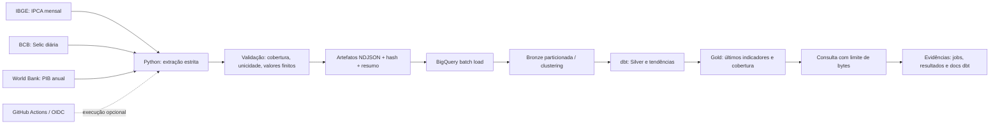

# Brazil Economic Pipeline · BigQuery + dbt

Extensão independente da versão SQLite. Demonstra ingestão de APIs públicas, carga em lote no BigQuery, transformações dbt, testes, controle de consultas e evidências de execução. O código não utiliza a conta nem o projeto corporativo configurado no computador.

**Status:** execução real validada no BigQuery em 29/10/2026: 75 observações públicas (36 IBGE, 36 BCB, 3 World Bank), quatro views e 16 testes dbt aprovados. Os 20 testes locais também passaram. Faturamento desativado no projeto dedicado; automação WIF/agendamento ainda não configurada. [Evidência da execução](evidence/2026-10-29-live-run.json).

A carga histórica 2022–2024 terminou em 210,659 segundos, incluindo extração, upload, dbt build, documentação e consulta final. A consulta final processou 4.905 bytes (mínimo contabilizado pelo job: 10 MiB); esse número não representa a soma dos jobs dbt nem cobrança monetária. Dados do Sandbox expiram, portanto esta evidência registra uma execução, não disponibilidade permanente das tabelas.

## Arquitetura



### Escopo dos dados

- **IBGE:** tabela 1737, variável 63, Brasil; IPCA mensal.
- **BCB:** série 432; usa a última observação diária disponível de cada mês para representar a Selic anualizada. Não calcula média mensal dessa taxa.
- **World Bank:** `NY.GDP.MKTP.KD.ZG`, Brasil; crescimento anual do PIB. Anos sem valor publicado são omitidos; a fonte deve ter ao menos uma observação válida.
- A janela padrão de referência é janeiro de 2022 a dezembro de 2024. É uma amostra histórica reproduzível, não um painel em tempo real. As APIs podem revisar valores históricos.
- Frequências anuais e mensais são mantidas separadas; a data anual representa o início do ano de referência, não a data de publicação nem disponibilidade naquele instante.
- O modo `live` nunca retorna dados sintéticos após uma falha. O modo `fixture` é explícito, marcado em cada linha e usa datasets distintos.
- A demonstração limita a janela a cinco anos e 20.000 observações. As duas fontes mensais devem cobrir todos os meses solicitados, sem duplicatas, NaN ou infinitos.

## 1. Testar sem conta Google e sem instalar pacotes

Na raiz do repositório:

```bash
cd bigquery
python -m unittest discover -s tests -v
python -m economic_bq extract --mode fixture
python -m economic_bq extract --mode live
```

Use `python3` quando esse for o nome do Python no seu sistema. Os testes do SDK ficam explicitamente ignorados até instalar `requirements.txt`; o restante usa a biblioteca padrão. O modo fixture produz 75 observações na janela padrão. A extração live consulta somente as APIs públicas e escreve arquivos locais, sem autenticação Google e sem upload.

Cada pasta `output/<run_id>/` contém `observations.ndjson` e `run.json`, com origem, quantidade, SHA-256 e tempos. `extracted_only` não significa execução na nuvem.

## 2. Criar um projeto dedicado no BigQuery Sandbox

Entre na [console BigQuery](https://console.cloud.google.com/bigquery) com sua conta escolhida e crie um projeto dedicado ao portfólio. Anote o **ID**, não apenas o nome exibido. O [Sandbox oficial](https://docs.cloud.google.com/bigquery/docs/sandbox) permite começar sem cartão, tem cotas e expiração de dados, e não aceita streaming nem DML. Esta versão usa load jobs e views, sem `MERGE`, streaming ou Cloud Storage.

Use um projeto dedicado à demonstração e confirme as políticas da conta escolhida antes de criar recursos. Nenhum comando usa automaticamente o projeto padrão do gcloud; `--project` ou `BQ_PROJECT` é obrigatório.

## 3. Isolar autenticação e instalar as dependências

Exemplo PowerShell, na raiz do repositório:

```powershell
$env:CLOUDSDK_CONFIG = "$PWD\.gcloud-portfolio"
gcloud auth login
gcloud config set project SEU_ID_DEDICADO
gcloud services enable bigquery.googleapis.com --project SEU_ID_DEDICADO
gcloud auth application-default login
gcloud auth application-default set-quota-project SEU_ID_DEDICADO

python -m venv .venv
.\.venv\Scripts\python -m pip install -r bigquery/requirements.txt
$env:BQ_PROJECT = 'SEU_ID_DEDICADO'
$env:BQ_LOCATION = 'US'
$env:BQ_MODE = 'live'
cd bigquery
..\.venv\Scripts\python -m economic_bq bootstrap
..\.venv\Scripts\python -m economic_bq run
```

Essa configuração gcloud fica no diretório local ignorado `.gcloud-portfolio`, sem substituir a configuração corporativa padrão. Não envie arquivos de autenticação ao GitHub ou por chat. O dbt usa Application Default Credentials com `method: oauth`, sem chave JSON de service account. `.env.example` é uma referência de variáveis; a CLI lê o ambiente ou os argumentos, não carrega `.env` automaticamente.

Em Linux/macOS, exporte `CLOUDSDK_CONFIG="$PWD/.gcloud-portfolio"`, crie a venv com `python3 -m venv .venv` e use `.venv/bin/python`. O destino e a região devem ser os mesmos na CLI e no dbt.

`bootstrap` cria somente os datasets com prefixo dedicado:

```text
portfolio_econ_live_bronze
portfolio_econ_live_silver
portfolio_econ_live_gold
```

Para uma demonstração sintética na nuvem, use `--mode fixture` tanto no bootstrap quanto no run. Os nomes passam a conter `_fixture_`. O código recusa tabelas/datasets existentes sem o rótulo de propriedade desta aplicação.

## 4. Transformações, testes e idempotência

Há quatro modelos dbt:

1. `stg_observations`: seleciona a janela de referência com filtro de partição obrigatório.
2. `economic_trends`: compara somente períodos consecutivos da mesma fonte, indicador, país e frequência. A diferença fica nula quando há uma lacuna, em vez de fingir comparação mensal/anual contínua.
3. `latest_indicators`: último período disponível para cada uma das três séries.
4. `quality_summary`: contagem, unicidade e limites temporais por série.

Os testes verificam chave única, nulos, domínios de fonte/frequência, presença das três fontes, valores finitos, alinhamento dos períodos e separação entre modos. Os testes configurados e seus resultados ficam no manifest e em `run_results.json`.

A chave de negócio é SHA-256 de fonte, indicador, país, frequência e período. Cada execução valida todas as fontes antes de iniciar o upload. O load job substitui **somente o snapshot da tabela de demonstração**, usando `WRITE_TRUNCATE`, não adiciona observações repetidas. Não é uma estratégia incremental e não preserva histórico de snapshots no BigQuery; os artefatos locais permitem rastrear cada execução.

Uma falha no load job não deve ser interpretada como publicação concluída. Não existe transação global entre upload e materializações dbt: se o dbt falhar após a carga, a Bronze pode estar atualizada e algumas views podem ter sido substituídas. O resumo registra `failed`; após corrigir a causa, reprocesse a janela completa. Timeouts do cliente também exigem consultar o job ID antes de repetir uma carga.

## 5. Consultar resultados e documentação

```powershell
..\.venv\Scripts\python -m economic_bq query
```

O resumo da execução cloud contém o load job ID, número de linhas aceitas, destino e o job da consulta final, com bytes processados/faturados. Os artefatos dbt mostram os resultados dos modelos e testes. Os bytes da consulta final não representam o custo total de todos os jobs.

Após uma execução completa, sirva os documentos gerados:

```powershell
..\.venv\Scripts\python -m http.server 8081 --directory output/SEU_RUN_ID/dbt-target
```

Abra `http://127.0.0.1:8081`. Os artefatos são gerados para a execução atual, não reutilizados de outro ambiente.

## 6. Limites e custos

- Limite padrão de **100.000.000 bytes por consulta**, aplicado tanto ao perfil dbt quanto à consulta Python. É um limite por job, não um orçamento mensal e não abrange armazenamento.
- Bronze particionada por `ingestion_date` (UTC), clusterizada por fonte/indicador/data de referência e com filtro de partição obrigatório. O dbt seleciona a partição da carga atual. Usar a data de ingestão evita que a expiração automática do Sandbox elimine imediatamente observações históricas de 2022–2024.
- Datasets têm expiração padrão de sete dias. Após cada load, a expiração da tabela Bronze é renovada para sete dias. Views podem expirar; refaça o build para recriá-las. É retenção de demonstração, não uma política de produção.
- Uma thread dbt; retries e tempos de espera limitados; nenhuma coleta em loop infinito.
- Confira cotas e jobs na console. Em projeto com faturamento habilitado, esses controles não garantem custo zero. Consulte [controle de custo de consultas](https://docs.cloud.google.com/bigquery/docs/best-practices-costs) e [restrições do Sandbox](https://docs.cloud.google.com/bigquery/docs/sandbox).

## 7. Agendamento opcional sem chaves estáticas

O workflow `bigquery-cloud.yml` está preparado para execução manual e agendamento diário às 11:00 UTC (08:00 em São Paulo, na configuração atual). O agendamento só executa a carga quando `BQ_ENABLE_SCHEDULE=true`. Não configure essa variável antes de validar uma execução manual e rever o consumo.

O workflow exige as variáveis do repositório:

| Variável | Uso |
|---|---|
| `BQ_PROJECT` | ID do projeto dedicado |
| `BQ_LOCATION` | Mesma região dos datasets |
| `GCP_WORKLOAD_IDENTITY_PROVIDER` | Provedor OIDC do GitHub |
| `GCP_SERVICE_ACCOUNT` | Conta de serviço da demonstração |
| `BQ_ENABLE_SCHEDULE` | `true` para ativar o agendamento |

Crie a federação seguindo a [documentação oficial da action](https://github.com/google-github-actions/auth). Restrinja a confiança ao repositório `gabrielassisp/Brazil-Pipeline-Project` e à branch `main`, e não a qualquer repositório GitHub. Faça o bootstrap com sua conta escolhida. Para executar, a conta de serviço precisa de `roles/bigquery.jobUser` no projeto e `roles/bigquery.dataEditor` somente nos três datasets da demonstração, além da autorização WIF de impersonação. Não conceda Owner ou Editor do projeto inteiro para o runtime.

O fluxo passa as credenciais efêmeras da action por ADC ao Python e ao perfil OAuth do dbt. A federação precisa ser validada no projeto real antes de anunciar o agendamento como operacional.

A CI sem cloud executa testes, extração fixture e `dbt parse` em pull requests. Esse parse verifica configuração e dependências; não valida permissões, faturamento, execução SQL no BigQuery ou autenticação WIF. Os artefatos de uma execução cloud são retidos por sete dias; logs de depuração e credenciais não são enviados como artefatos.
